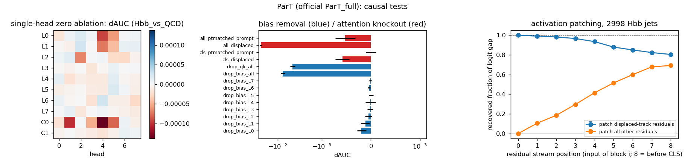

# What does ParT learn? Attention circuits behind b-tagging

**Question.** The Particle Transformer (ParT) is a strong jet tagger. It reaches AUC about 0.99 for H→bb̄ vs QCD on JetClass. Which internal mechanism does it use to separate H→bb̄ (and H→cc̄, top) from QCD? b-hadrons travel a few mm before they decay. That produces tracks with large transverse impact parameter (|d0|/σ) that come from a common secondary vertex. Does ParT build that "displaced-track cluster" concept explicitly, and where? Does it use attention content (QK) or its pairwise-interaction bias ψ(U)? And is the mechanism causally necessary, or only correlated with the output?

This repository has the tools, Kaggle jobs, results and paper draft for a short arXiv note / ML4PS workshop paper. The main subject is the **official pretrained `ParT_full`** checkpoint from [jet-universe/particle_transformer](https://github.com/jet-universe/particle_transformer/tree/main/models). The same analysis is also run on [GDS-ParT](https://github.com/Avinashistoocool/Gated-Dual-Stream-Particle-Transformer) as a comparison model.

## Method

ParT's particle attention is

$$A^{(l,h)} = \mathrm{softmax}\big(\underbrace{Q K^\top/\sqrt{d}}_{\text{content}} + \underbrace{\psi(U)_h}_{\text{interaction bias}}\big)$$

Here U holds the pairwise features (ln ΔR, ln kT, ln z, ln m²). The ψ(U) bias is computed once per jet and shared by all 8 layers. Two class-attention blocks then let a CLS token read the particles. `src/partinterp/models.py` re-runs the weaver-core model with the same modules and weights. It computes every attention explicitly, so it can **record** each term and **intervene** on it. Tests check that the instrumented forward reproduces the original logits and that `qk + bias` reconstructs the softmax input exactly.

| # | analysis | what is measured |
|---|---|---|
| 1 | CLS attention vs particle properties | share of CLS attention / population share for displaced tracks (\|d0\|/σ > 3), e/μ, prompt charged, neutral, 3 leading-pT particles; within-jet regression of log attention on ln pT, ΔR to axis, displacement, lepton, charge |
| 2 | head specialisation | per head: Spearman ρ between attention and ln ΔR, ln kT, ln z, ln m²; "same secondary vertex" proxy = attention from displaced to displaced tracks relative to the random expectation, with a per-jet permutation null |
| 3 | bias vs content | per layer/head, share of within-row logit variance from ψ(U) vs QK, their correlation, and the total-variation change in attention when either term is removed |
| 4 | causal tests | zero-ablation of every head (80); ψ(U) removal per layer; top-5 heads vs random 5-head sets; attention knockout of displaced tracks vs pT-matched prompt tracks; activation patching (clean H→bb̄ vs the same jet with displaced-track impact parameters zeroed), on residual-stream subsets and on single heads. Metrics: ΔAUC, Δ logit, rejection ratio at fixed signal efficiency |
| 5 | linear probes | logistic probes on per-particle residual streams after each block for *is displaced*, *is lepton*, *displaced track within ΔR < 0.4*, with held-out jets, shuffled-label and random-init-network controls |

Uncertainties are 68% bootstrap intervals over **jets**. Particles inside a jet are correlated, so they are not resampled independently.

## Results (Kaggle, GPU, JetClass validation split)

**ParT runs:**

- **Main run:** official `ParT_full`, 10 classes × 20k jets.
- **Replica:** independent files, 4 classes × 10k jets, new seed.

GDS-ParT was run with the same setup. Both ran on Tesla T4 GPUs. The full write-up, which separates robust results from null results, is in **[docs/FINDINGS.md](docs/FINDINGS.md)**. All tables are in [`results/REPORT_kaggle.md`](results/REPORT_kaggle.md).

Robust findings for ParT, H→bb̄ vs QCD. Each reproduces in the replica within about 0.05; brackets are 68% jet-bootstrap intervals.

1. **The classifier reads displaced tracks.**
   - In H→bb̄ jets the CLS attention per displaced track (|d0|/σ > 3) is 1.65× [1.64, 1.66] its population share. In QCD it is 1.15×.
   - In a within-jet regression, "is displaced" is the largest predictor of CLS attention (+0.57 ± 0.01).
2. **Displacement is causally necessary and specific.** Removing displaced tracks as attention keys costs ΔAUC −0.024 [−0.026, −0.023], and R99 drops to 1/20. Removing the same number of pT-matched prompt tracks costs −0.0005.
3. **The information stays on the displaced tokens.** Zeroing their impact parameters collapses log p(Hbb)/p(QCD) from 7.3 to 0.1. Restoring only the displaced tokens' residual stream at the CLS input recovers 80% of that gap.
4. **ψ(U) dominates the attention logits, but QK groups displaced tracks.**
   - The interaction bias ψ(U) accounts for 66–88% of attention-logit variance.
   - The displaced→displaced ("secondary-vertex-like") attention is produced by the QK content term: enrichment 3.0 with QK alone vs 1.7 with ψ(U) alone; permutation null ≤ 1.6. The top head is L6.h4 at 3.35, and 3.31 in the replica.
5. **The model builds neighbourhood features.** "A displaced track within ΔR < 0.4" becomes linearly decodable after one block: probe AUC 0.88–0.93, vs 0.74–0.77 for a random-init network.
6. **GDS-ParT uses a different route.** It spreads displacement information to the other particles early: restoring only the other particles recovers 94% at the CLS input, vs 69% for ParT. It also relies more on ψ(U): removing it costs ΔAUC −0.036, vs −0.008 for ParT.

**Null results:** no single head is necessary (|ΔAUC| ≤ 0.0002, the same as random heads), and the "top-5 heads" selection does not replicate.



## Layout

```
src/partinterp/      models.py (instrumented ParT / GDS-ParT), data.py (JetClass + ParT_full preprocessing),
                     analyses.py (analyses 1-5 + statistics), plots.py, vendor/ (weaver-core ParT, GDS-ParT; MIT)
scripts/             run_analysis.py, make_report.py, fetch_jetclass_test.py, push_kaggle.ps1
kaggle/              kernel_template.py, part-interp-part/, part-interp-gds/ (kernel-metadata.json)
tests/               CPU smoke tests (tiny random ParT / GDS-ParT on synthetic jets)
paper/               LaTeX workshop-paper skeleton
docs/PLAN.md         milestones toward ML4PS
results/             Kaggle results (results.json, figures, logs) + REPORT_kaggle.md
docs/FINDINGS.md     findings with uncertainties, robust vs null
```

## Usage

```powershell
pip install -r requirements.txt
python -m pytest tests -q                                   # ~15 s on CPU

# pretrained ParT (MIT, jet-universe/particle_transformer)
curl.exe -L -o checkpoints/ParT_full.pt https://raw.githubusercontent.com/jet-universe/particle_transformer/main/models/ParT_full.pt
# one JetClass test file per class via HTTP range requests (~140-190 MB each)
python scripts/fetch_jetclass_test.py --out data/JetClass/test --classes QCD,Hbb,Hcc,Tbqq
python scripts/run_analysis.py --model part --ckpt checkpoints/ParT_full.pt --data_dir data/JetClass/test `
    --classes QCD,Hbb,Hcc,Tbqq --n_per_class 5000 --random_control --out results/local_part
python scripts/make_report.py results/local_part results/local_gds --out results/REPORT_local.md

# focused controls on the validation split (requires both official checkpoints)
curl.exe -L -o checkpoints/ParT_kin.pt https://raw.githubusercontent.com/jet-universe/particle_transformer/main/models/ParT_kin.pt
python scripts/run_robustness.py --ckpt checkpoints/ParT_full.pt --kin_ckpt checkpoints/ParT_kin.pt `
    --data_dir data/JetClass/val --n_per_class 300 --out results/robustness_val
```

The focused control script uses the same QCD/Hbb jets and seeds for thresholds
2/3/5, compares displaced-key knockout with pT-matched prompt-key knockout,
compares zero-d0, zero-d0-and-dz, and per-jet prompt-mean replacement, and
repeats attention/knockout measurements with the official seven-input
`ParT_kin` model. Its JSON records bootstrap intervals and the number of jets
left unchanged when a prompt-mean reference does not exist. Kinematics-only
does not accept impact-parameter features, so it has no corruption result.
These controls use a smaller sample, but the first 300 jets in `*_120.root`
overlap the Kaggle main sample; they are not an independent replication.

### Kaggle (heavy runs)

The kernels attach the Kaggle dataset `suryatrainer/jetclass-val`. It holds the JetClass validation files `*_120…124.root`, which were not used for ParT training. The kernels clone this repo, download the checkpoint, and run the main sample (20k jets/class, 10 classes) plus a replica on independent files with a different seed. If the dataset is not mounted, they fall back to a Zenodo range download.

```powershell
powershell -ExecutionPolicy Bypass -File scripts\push_kaggle.ps1          # username from $env:KAGGLE_USERNAME or `kaggle config view`
kaggle kernels status <user>/part-interp-part
kaggle kernels output <user>/part-interp-part -p results/kaggle_part
```

## Caveats

- `ParT_full` was trained on the JetClass training split. Local pilots use the **test** split and the Kaggle runs use the **validation** split, so neither overlaps training.
- The "displaced" label uses reco-level |d0|/σ(d0) > 3. It is a proxy for b/c-decay products and does not use truth vertex matching. JetClass has no per-particle truth.
- Attention-weight analyses are correlational. The causal claims rest only on the ablation and patching results in section 4.
- The patching corruption (zeroing d0/dz of displaced tracks) is off-distribution for prompt tracks with the same pT. That is why the pT-matched prompt-track knockout is reported as a control.

## References

1. H. Qu, C. Li, S. Qian, *Particle Transformer for Jet Tagging*, ICML 2022, [arXiv:2202.03772](https://arxiv.org/abs/2202.03772).
2. H. Qu, C. Li, S. Qian, *JetClass: A Large-Scale Dataset for Deep Learning in Jet Physics*, Zenodo, [10.5281/zenodo.6619768](https://doi.org/10.5281/zenodo.6619768).
3. weaver-core, [github.com/hqucms/weaver-core](https://github.com/hqucms/weaver-core) (ParT implementation, MIT).
4. A. Khot, M. S. Neubauer, A. Roy, *A detailed study of interpretability of deep neural network based top taggers*, MLST 4 (2023) 035003, [arXiv:2210.04371](https://arxiv.org/abs/2210.04371).
5. F. A. Dreyer, H. Qu, *Jet tagging in the Lund plane with graph networks*, JHEP 03 (2021) 052, [arXiv:2012.08526](https://arxiv.org/abs/2012.08526).
6. G. Kasieczka et al., *The Machine Learning Landscape of Top Taggers*, SciPost Phys. 7 (2019) 014, [arXiv:1902.09914](https://arxiv.org/abs/1902.09914).
7. S. Jain, B. C. Wallace, *Attention is not Explanation*, NAACL 2019, [arXiv:1902.10186](https://arxiv.org/abs/1902.10186).
8. K. Meng, D. Bau, A. Andonian, Y. Belinkov, *Locating and Editing Factual Associations in GPT* (activation patching), NeurIPS 2022, [arXiv:2202.05262](https://arxiv.org/abs/2202.05262).
9. Y. Belinkov, *Probing Classifiers: Promises, Shortcomings, and Advances*, Computational Linguistics 48 (2022), [arXiv:2102.12244](https://arxiv.org/abs/2102.12244).
10. H. Touvron et al., *Going deeper with Image Transformers* (CaiT class attention), ICCV 2021, [arXiv:2103.17239](https://arxiv.org/abs/2103.17239).

Verify the exact bibliographic details of refs 4-6 before submission. They were cited from memory.

## License and attribution

MIT (see `LICENSE`). `src/partinterp/vendor/ParticleTransformer.py` is vendored from weaver-core v0.4.17 (MIT, © Huilin Qu). The only change is that the logger import was replaced. `ParT_full.pt` is downloaded from jet-universe/particle_transformer (MIT) and is not redistributed here. `src/partinterp/vendor/gds_part_colab.py` is copied from GDS-ParT (MIT, © 2026 Avinash). License texts are in `LICENSES/`.
